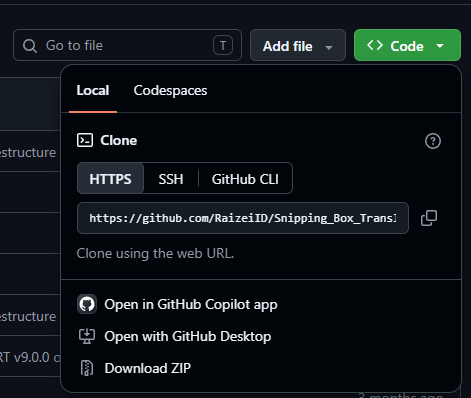
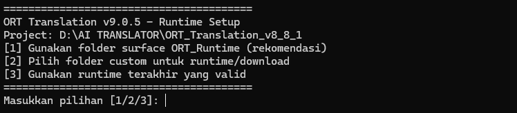
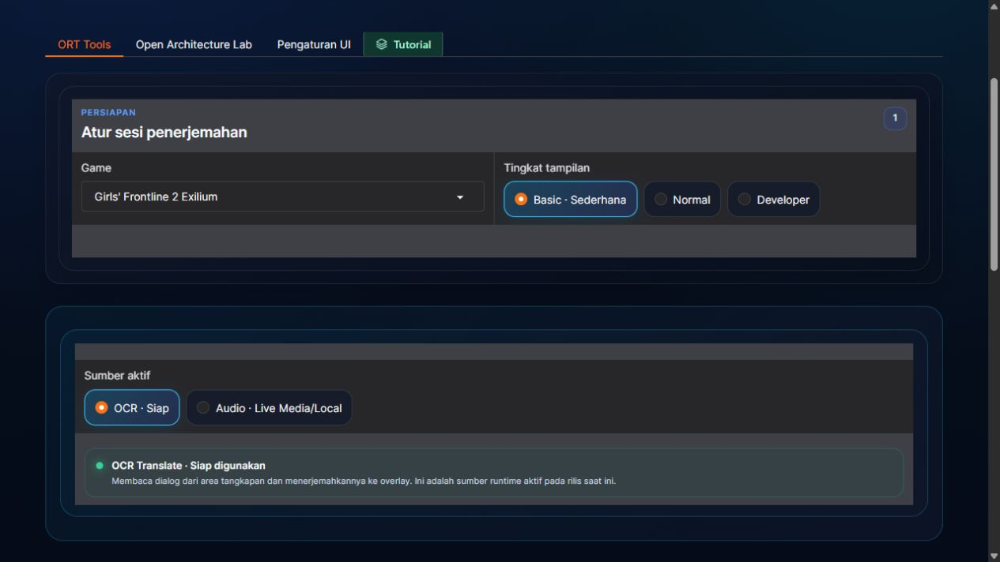
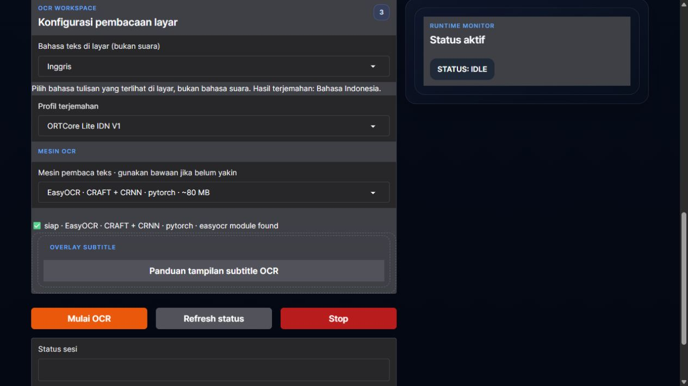
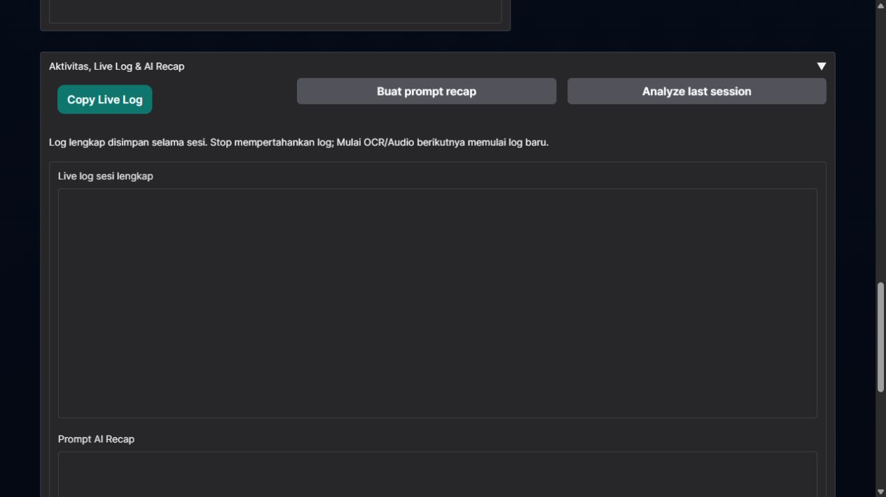

# Tentang ORT Translation

**ORT (Optic Recognition Text) Translation**

ORT Translation adalah aplikasi Windows untuk membantu menerjemahkan teks di layar dan ucapan ke Bahasa Indonesia. Anda dapat memakainya ketika bermain game, membaca visual novel, atau menonton media yang belum menyediakan terjemahan Indonesia.

Untuk terjemahan layar, ORT membaca tulisan di area yang Anda pilih menggunakan OCR, mengolah hasil bacaan, lalu menampilkan terjemahannya melalui overlay. Anda tetap dapat melanjutkan game tanpa menyalin setiap kalimat secara manual.

Ada dua sumber terjemahan:

- **OCR:** menerjemahkan tulisan yang terlihat di layar. Cocok untuk dialog game, subtitle yang menyatu dengan video, dan teks pada gambar.
- **Audio:** mengenali ucapan dari suara, lalu menerjemahkannya. Runtime, model, dan sumber suara perlu disiapkan sesuai mesin Audio yang dipilih.

**ORT Tools** adalah workspace utama untuk penggunaan sehari-hari. **Open Architecture Lab** tersedia untuk mencoba provider dan pendekatan lain. Panduan di README ini berfokus pada **mode Basic** agar pengguna baru dapat langsung memulai.

> Versi aplikasi: **v9.0.5** · Platform: **Windows 10/11 64-bit**. Source di GitHub tidak menyertakan environment Python, model besar, kredensial, atau log pribadi. Komponen yang diperlukan disiapkan saat instalasi dan penggunaan pertama.

## Daftar Isi

- [Tutorial Pemasangan](#tutorial-pemasangan)
- [Tiga File Utama](#tiga-file-utama)
- [Tutorial Penggunaan Basic](#tutorial-penggunaan-basic)
- [Melihat dan Menyalin Log Dialog](#melihat-dan-menyalin-log-dialog)
- [Merangkum Dialog dengan Bantuan AI](#merangkum-dialog-dengan-bantuan-ai)
- [Shortcut OCR](#shortcut-ocr)
- [Kebutuhan Perangkat dan Penyimpanan](#kebutuhan-perangkat-dan-penyimpanan)
- [Pemecahan Masalah](#pemecahan-masalah)
- [Data Lokal dan Privasi](#data-lokal-dan-privasi)
- [Struktur Folder](#struktur-folder)

## Tutorial Pemasangan

### 1. Unduh dari GitHub

1. Buka [repository Snipping Box Translation](https://github.com/RaizeiID/Snipping_Box_Translation).
2. Pastikan Anda berada pada branch **main** untuk mengikuti paket pada panduan ini.
3. Tekan tombol hijau **Code**.
4. Pilih **Download ZIP**, lalu tunggu unduhan selesai.



### 2. Ekstrak ZIP

Klik kanan ZIP yang sudah diunduh, lalu pilih **Extract All / Ekstrak Semua**. Buka folder hasil ekstraknya, biasanya bernama `Snipping_Box_Translation-main`.

Jalankan aplikasi dari folder hasil ekstrak, bukan dari dalam ZIP. Simpan seluruh folder proyek bersama-sama agar launcher dapat menemukan source aplikasi dan dependensinya.

Di folder utama terdapat tiga launcher berikut:


### 3. Jalankan Instalation First.bat untuk pemasangan pertama

**Untuk pertama kali memakai paket ini, jalankan `Instalation First.bat`.** File ini membuka setup runtime untuk menyiapkan environment Python, PyTorch, dan dependensi dasar aplikasi.

Sebelum memulai, siapkan:

- **Python 3 64-bit** yang dapat dipanggil melalui `py` atau `python` di terminal. Runtime pengembangan saat ini memakai Python 3.12; versi Python yang terlalu baru dapat belum memiliki wheel untuk dependensi yang dikunci.
- **Koneksi internet** untuk mengunduh dependensi dan model yang belum tersedia.
- **Sekitar 3–5 GB ruang kosong sebagai persiapan awal.** Kebutuhan akhirnya dapat lebih besar, khususnya untuk paket CUDA, cache unduhan, dan model tambahan. Jangan menganggap 5 GB sebagai batas maksimum seluruh fitur.

Jika Python belum terpasang, ambil installer dari [situs resmi Python untuk Windows](https://www.python.org/downloads/windows/). Aktifkan pilihan **Add Python to PATH** bila tersedia.

### 4. Pilih lokasi runtime yang direkomendasikan

Terminal akan menampilkan pilihan seperti ini:



Untuk penggunaan pertama, ketik **`1`**, lalu tekan **Enter**:

```text
[1] Gunakan folder surface ORT_Runtime (rekomendasi)
```

Pilihan ini menempatkan runtime pada folder `ORT_Runtime` di dalam proyek sehingga lebih mudah ditemukan dan dikelola. Anda tidak perlu menentukan folder lain secara manual.

Pilihan `[2]` digunakan bila memang ingin menyimpan runtime di lokasi lain. Pilihan `[3]` hanya muncul jika sebelumnya sudah ada runtime tersimpan yang dianggap valid.

### 5. Tunggu unduhan dan pemasangan selesai

Setelah memilih lokasi, terminal akan mulai menyiapkan environment dan mengunduh paket yang diperlukan. Biarkan terminal tetap terbuka. Lama proses bergantung pada internet, penyimpanan, dan perangkat.

Jika pemasangan dependensi berhasil, launcher akan menjalankan WebUI dan aplikasi mencoba membuka browser secara otomatis ke:

**http://127.0.0.1:7860**

Beberapa model OCR atau terjemahan masih dapat memerlukan unduhan ketika fitur pertama kali dijalankan. Model dan provider tambahan, terutama Audio, disiapkan melalui pengaturan yang tersedia di aplikasi.

### 6. Jika unduhan gagal atau web belum terbuka

- **Jika unduhan/pemasangan gagal:** periksa koneksi dan ruang kosong, jalankan kembali `Instalation First.bat`, lalu pilih `[1] ORT_Runtime` lagi. Paket yang sudah terpasang dapat digunakan kembali; paket yang belum selesai mungkin perlu diunduh ulang.
- **Jika dependensi sudah selesai tetapi web belum terbuka:** jalankan **`Start WebUI.bat`**. Jika terminal sudah menunjukkan server berjalan, buka alamat `http://127.0.0.1:7860` secara manual terlebih dahulu agar tidak membuka proses kedua.
- **Jika terminal menampilkan error:** simpan pesan errornya. Membuka ulang browser tidak memperbaiki server yang gagal berjalan; lihat [Pemecahan Masalah](#pemecahan-masalah).

Untuk pemakaian berikutnya, cukup jalankan **`Start WebUI.bat`**. Tetap biarkan terminal terbuka selama menggunakan ORT.

## Tiga File Utama

| File | Digunakan untuk |
|---|---|
| **`Instalation First.bat`** | Pemasangan pertama atau mengulang setup runtime/dependensi yang belum selesai. |
| **`Start WebUI.bat`** | Membuka aplikasi menggunakan runtime tersimpan dan membuka antarmuka web. |
| **`Repair Struktur ORT.bat`** | Migrasi/perbaikan struktur folder dan verifikasi instalasi. Tidak perlu dijalankan setiap hari. |

## Tutorial Penggunaan Basic

### 1. Buka ORT Tools dan pilih sumber OCR

1. Buka **`Start WebUI.bat`** dan tunggu WebUI siap.
2. Pilih **ORT Tools**.
3. Pada **Tingkat tampilan**, pilih **Basic · Sederhana**.
4. Pilih **Game** yang sesuai.
5. Pada **Sumber aktif**, pilih **OCR** untuk menerjemahkan tulisan di layar.



**OCR dan Audio berbeda:** OCR membaca tulisan yang terlihat. Audio mengenali ucapan dari suara. Untuk tutorial terjemahan layar di bawah, gunakan OCR. Jika memilih Audio, ikuti pemeriksaan kesiapan runtime/model dan sumber suara pada panel Audio, lalu gunakan tombol **Mulai Audio**; tidak ada langkah memilih kotak dialog seperti OCR.

### 2. Pilih bahasa tulisan dan gunakan pengaturan bawaan

Pada **Bahasa teks di layar**, pilih bahasa yang benar-benar tertulis di game.

Contoh: game bersuara Jepang tetapi teks dialognya Inggris tetap menggunakan pilihan **Inggris**. Hasil terjemahan ditampilkan dalam Bahasa Indonesia.

Untuk sesi pertama, biarkan **profil terjemahan dan mesin pembaca pada pilihan bawaan/rekomendasi tools**. Basic menerapkan konfigurasi teknis profil serta pilihan perangkat sesuai kemampuan yang terdeteksi. Anda tidak perlu mengatur resolusi, thread, atau resource secara manual untuk mulai mencoba.

Nilai dan nama profil pada screenshot adalah contoh dari satu instalasi; pilihan yang sesuai dapat berbeda menurut perangkat dan game.



### 3. Tekan Mulai OCR

Buka game dan tampilkan dialog yang ingin dibaca, lalu tekan **Mulai OCR** di WebUI. Tunggu beberapa saat sampai model dan OCR siap. Penggunaan pertama dapat membutuhkan waktu lebih lama.

Jangan menekan Mulai berulang kali. Bila belum ada pemilih area, buka **Aktivitas, Live Log & AI Recap** untuk melihat proses dan pesan kesalahan.

### 4. Tandai area dialog game

Saat pemilih area siap, **layar sedikit menggelap dan kursor berubah menjadi tanda `+`**. Kemudian:

1. Arahkan kursor ke **ujung kiri atas** area dialog.
2. **Tekan dan tahan tombol kiri mouse.**
3. Tarik ke **ujung kanan bawah** sampai seluruh teks dialog masuk ke dalam kotak. Sertakan nama karakter jika ingin ikut dibaca.
4. **Lepaskan tombol mouse.** Area akan dikunci dan OCR mulai membaca teks di dalamnya.

Hindari memasukkan menu, tombol, atau bagian layar lain yang tidak diperlukan. Jika salah memilih area atau kotak dialog berpindah, tekan **F2** untuk memilih ulang.

### 5. Lanjutkan dialog dan baca overlay

Pada Basic, sesi dimulai dengan pembacaan **Auto**. ORT mengikuti perubahan teks dalam area yang dipilih dan menampilkan hasil terjemahan melalui overlay.

- Tekan **F1** untuk jeda, lalu tekan lagi untuk melanjutkan.
- Gunakan **F4–F8** untuk menyesuaikan gaya, posisi, ukuran huruf, dan lebar overlay.
- Tekan **Stop** di WebUI untuk mengakhiri sesi.

Tombol **Tutorial** setelah **Runtime & Tools** pada navigasi membuka popup panduan dengan screenshot, ilustrasi menarik kotak, dan kartu shortcut. Popup dapat ditutup dengan **×** tanpa mengganti workspace. Tutorial mengikuti tingkat tampilan aktif; panduan README ini hanya membahas Basic.

## Melihat dan Menyalin Log Dialog

Log membantu Anda melihat hasil OCR, proses terjemahan, perangkat yang digunakan, dan pesan kesalahan. Log juga dapat dipakai untuk menyusun catatan cerita dari dialog yang sudah diterjemahkan.

1. Di ORT Tools, buka panel **Aktivitas, Live Log & AI Recap**. Panel ini tersedia pada Basic.
2. Selama OCR berjalan, log sesi akan terus bertambah.
3. Tekan **Copy Live Log** untuk menyalin isi yang tersedia, lalu tempel ke file `.txt` agar mudah disimpan atau dibagi menjadi beberapa bagian.



Riwayat tampilan disimpan dari awal sampai akhir satu sesi tanpa pemotongan berdasarkan jumlah baris. **Stop mempertahankan log yang terlihat; memulai sesi OCR baru mereset tampilan log untuk sesi baru.** Pergantian tingkat tampilan tidak menghapus riwayat.

Salinan log sesi juga disimpan pada folder log aplikasi, biasanya di `ORT_App/logs/`. Untuk sesi panjang, simpan file log lengkap atau salin sebelum memulai sesi berikutnya.

Log teknis dapat memuat bacaan OCR sementara, pengulangan, dan informasi proses. Karena itu, isi log perlu dipilah terlebih dahulu bila ingin dijadikan catatan alur cerita.

## Merangkum Dialog dengan Bantuan AI

Anda dapat menempelkan log ke AI pilihan Anda, misalnya ChatGPT, lalu meminta ringkasan. AI digunakan untuk membantu menyusun catatan; dialog yang salah terbaca atau tidak tertangkap tidak boleh dianggap sebagai fakta cerita baru.

Contoh prompt:

```text
Saya akan memberikan log dialog game dari ORT Translation.

Tolong susun catatan cerita berdasarkan isi log ini saja:
1. Abaikan baris teknis seperti BOOT, GPU, cache, queue, dan waktu proses.
2. Pisahkan dialog asli, hasil OCR sementara, dan terjemahan jika dapat dikenali.
3. Gabungkan pengulangan dari kalimat yang sama tanpa menghilangkan dialog berbeda.
4. Buat ringkasan kejadian sesuai urutan, daftar tokoh, dan poin penting percakapan.
5. Pertahankan nama tokoh dan istilah yang ada di log.
6. Tandai bagian yang tidak jelas atau kemungkinan salah OCR.
7. Jangan menambahkan peristiwa, motivasi, atau hubungan tokoh yang tidak didukung log.

Format hasil:
- Ringkasan singkat
- Urutan kejadian
- Tokoh dan perannya dalam percakapan
- Dialog atau informasi penting
- Bagian yang masih perlu diperiksa

Berikut lognya:
[tempel log di sini]
```

Jika log terlalu panjang untuk satu pesan, kirim dalam bagian berurutan, misalnya **Bagian 1/4** sampai **Bagian 4/4**. Minta AI menunggu semua bagian sebelum membuat alur lengkap, atau ringkas tiap bagian lalu gabungkan dengan tetap mempertahankan urutan.

Sebelum membagikan log, periksa dan hapus informasi pribadi, lokasi file pribadi, atau token/API key bila ada. Fitur rangkuman pada layanan AI mengikuti batas panjang dan kebijakan layanan yang Anda gunakan.

## Shortcut OCR

Shortcut berikut berlaku saat runtime OCR aktif. Pada beberapa laptop, tombol fungsi perlu ditekan bersama **Fn**.

| Tombol | Fungsi |
|---|---|
| **F1** | Jeda / lanjutkan OCR. |
| **F2** | Pilih ulang area dialog. |
| **F3** | Ganti strategi tangkap runtime; periksa indikator mode pada overlay. |
| **F4** | Ganti gaya subtitle. |
| **F5** | Ganti posisi overlay. |
| **F6 / F7** | Kecilkan / besarkan huruf. |
| **F8** | Ganti lebar overlay. |
| **F9** | Ganti perangkat OCR pada sesi berjalan. |
| **F10** | Tangkap satu gambar ketika menggunakan Freeze. |
| **F11** | Aktifkan / matikan tangkapan otomatis Interval. |
| **Esc** | Akhiri runtime OCR. Gunakan **×** untuk menutup popup Tutorial saat OCR aktif. |

Untuk pemakaian pertama di Basic, cukup pahami **F1, F2, dan Stop** terlebih dahulu. Shortcut lengkap beserta ikon tersedia di popup Tutorial.

## Kebutuhan Perangkat dan Penyimpanan

- Windows 10/11 **64-bit** dan Python 3 64-bit yang kompatibel dengan dependensi.
- Internet saat memasang paket atau mengunduh model yang belum tersedia.
- RAM dan ruang penyimpanan yang cukup untuk game, OCR, serta model yang dipilih. Siapkan sekitar **3–5 GB untuk awal**, dengan ruang tambahan untuk CUDA, cache, dan model lain.
- GPU bukan syarat mutlak untuk OCR. Kecepatan dipengaruhi perangkat, bahasa, font game, ukuran area tangkapan, dan beban game.
- Paket PyTorch CUDA yang disertakan dikunci pada stack tertentu. Terdeteksinya NVIDIA tidak menjamin semua generasi GPU kompatibel; baca log jika inisialisasi GPU gagal.

Setelah semua model yang digunakan tersedia, jalur penerjemahan lokal dapat dipakai tanpa unduhan ulang. Provider online atau cloud tetap memerlukan internet dan dapat memerlukan kredensial serta biaya layanan.

## Pemecahan Masalah

| Masalah | Yang perlu diperiksa |
|---|---|
| `py` / `python` tidak ditemukan | Pasang Python 64-bit dan pastikan dapat dipanggil dari terminal. Buka ulang terminal setelah pemasangan. |
| Pemasangan terputus | Periksa internet/ruang kosong, jalankan `Instalation First.bat`, lalu pilih `[1]` lagi. |
| Browser tidak terbuka | Bila server sudah berjalan, buka `http://127.0.0.1:7860`. Bila belum berjalan, gunakan `Start WebUI.bat` dan baca pesan terminal. |
| Port 7860 sudah dipakai | Periksa apakah ORT sudah berjalan pada terminal lain. Gunakan sesi yang sudah ada atau tutup sesi lama sebelum membuka ulang. |
| Layar belum meredup | Tunggu pemuatan model dan baca Live Log. Error pada runtime perlu diselesaikan sebelum pemilih area muncul. |
| OCR membaca tulisan yang salah | Periksa bahasa tulisan dan gunakan F2 untuk menandai ulang area dialog. |
| GPU gagal / `no kernel image is available` | Ada masalah kompatibilitas CUDA/perangkat. Periksa perangkat efektif di log; aplikasi mungkin beralih ke CPU. Mode Basic bukan penyebab kompatibilitas kernel CUDA. |
| Model atau provider belum siap | Ikuti pesan kesiapan yang ditampilkan; fitur Audio dan provider tambahan memiliki kebutuhan tersendiri. |
| Struktur folder tidak ditemukan | Pastikan ZIP sudah diekstrak lengkap. Gunakan `Repair Struktur ORT.bat` untuk migrasi/perbaikan struktur jika diperlukan. |

## Data Lokal dan Privasi

Runtime, model besar, cache, log, preferensi, dan data hasil pemakaian berada pada perangkat pengguna. Berkas ini tidak diperlukan untuk mengunduh source dari GitHub.

Simpan cadangan data lokal sebelum mengganti paket atau memperbarui instalasi. Jangan mengunggah kredensial, API key, atau seluruh folder runtime ketika melaporkan masalah. Untuk pemeriksaan awal, cukup sertakan pesan error, mode yang dipilih, dan spesifikasi perangkat yang relevan.

## Struktur Folder

```text
Snipping_Box_Translation-main/
├── Instalation First.bat     # Pemasangan awal
├── Start WebUI.bat           # Membuka aplikasi
├── Repair Struktur ORT.bat   # Perbaikan/migrasi struktur
├── README.md                # Panduan ini
├── VERSION.txt
├── docs/images/             # Screenshot panduan
├── ORT_App/                 # Source aplikasi dan aset tutorial
├── ORT/                     # Dokumentasi dan alat pendukung
└── ORT_Runtime/             # Dibuat/diisi saat setup; tidak disertakan dalam source
```

Dokumentasi pendukung: [catatan paket](ORT/docs/README.md) dan [source aplikasi](ORT_App/README.md).
